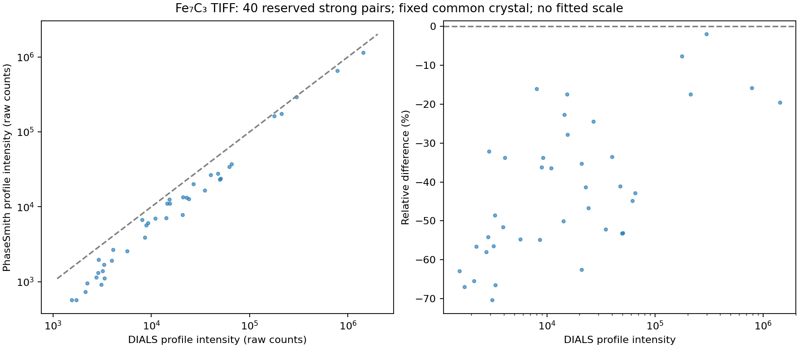

# Fe7C3 learned profile integration compared with DIALS

**Historical research record.** Measurements and conclusions below apply to their
recorded builds. The 3 November 2026 [reconciliation](integration/unfinished-work-reconciliation.md)
retains this evidence and adapts reproduction helpers to the supported API; it
does not rerun or replace the historical scientific comparisons.

**Historical first model.** The original 40-pair result below is preserved.
The [subsequent bias investigation](fe7c3-profile-bias-investigation.md) adds
scattering-plane coordinates, strong-only width transfer and a different
reflection-family validation protocol on two scans. It substantially reduces the
median discrepancy but does not yet validate all individual intensities.

25 October 2026. PhaseSmith now implements a programmable learned three-dimensional
profile estimator, but this TIFF comparison **does not validate its intensity
accuracy**. Among 40 reserved strong reflections with adequate coverage and clear
input-quality flags, the median difference from DIALS is **−43.8%**, with a 90th
percentile absolute difference of **63.1%**. The correlation of 0.9986 mostly shows
that the ordering and large dynamic range agree; it does not remove the bias.
No scale was fitted or applied to these intensities.

## Measurement and comparison conventions

The example is the 76 TIFF files `Fe7C3_P1_C3_D1s_010.tif` through `_085.tif` in
`~/Dropbox/Science/_Archive/Fe7C3 Single crystal PVT EOS/Fe7C3_SC/`. Each image is
2048 × 2048 pixels and covers a full 1° exposure, spanning −128° to −52°.

The affine geometry comes from the matching `Calibration/LaB6_p49_001.poni`,
wavelength 0.3100 Å, calibration SHA-256
`022575d4d9b4463c2cab6c07c4f719a900b2fe29721c535ce5d063028702b8e7`.
Each TIFF is flipped vertically once, exactly as in the preserved Dioptas/DIALS
pixel adapter; every frame is checked for exact array equality. Values at the
uint16 ceiling of 65,535 are unavailable measurements. Zero pixels are masked.
The older 0.414915 Å Fit2D/MAR calibration is outside this test.

Both programs use the same frozen crystal already indexed from these images by
DIALS, with no intensity-driven geometry refinement in this comparison. This is
a post-indexing integration test, not independent validation of cell finding.
Native detector pixel centres equal DIALS pixel coordinates minus 0.5. HKL and
Bragg crossing angle identify matches; detector coordinates independently check
the match. All 3,274 native predictions match uniquely, with maximum positional
differences below 1.2 × 10⁻¹² pixels and angular differences below 3.3 × 10⁻¹³°.
DIALS retains 3,371 predictions including detector-margin/near-spindle crossings.
Six native crossings with |zeta|<0.05 are explicitly excluded and listed in the
protocol. Native zeta values agree with DIALS's public calculation to 1.1 × 10⁻¹⁵.

The external environment contains DIALS 3.30.1 (its version function reports
3.30). It supplies no production runtime dependency. The new restricted-training
run has 495 reference observations, 2,295 sum-integrated rows, 1,864
profile-integrated rows and 55 overloaded rows. This is a separate run from the
older unrestricted-reference probe recorded in the methods review.

Comparisons use raw `intensity.prf.value` and `intensity.sum.value`. No LP,
efficiency, absorption, symmetry merging or scaling is applied. DIALS's later
scaling path applies those factors separately. Primary pairs require DIALS
partiality and native observed profile mass both at least 0.99.

## Learning and reserved observations

The first 20 exposures, −128° to −108°, are reserved from intensity-template
training. Both programs use the same frame reservation. Native reflection
windows crossing the partition boundary teach neither the training nor the
reserved population. Geometry was fitted before this split, so this is an
intensity-template reservation rather than an untouched image split.

There are 2,294 native training candidates, 732 reserved candidates and 248
partition-crossing candidates. Strong/isolated/full-coverage/centroid/endpoint
checks select 200 native references. A 2 × 2 detector partition and two scan
blocks supply eight local banks. Reference counts are 5, 7, 11, 7, 36, 47, 43,
and 44; banks below eight references fall back explicitly to the global bank.

Profiles have 19 × 19 × 13 voxels with steps 1 pixel, 1 pixel and 0.25° in the
signed coordinate zeta × (omega − omega_B). The collection radius is 11 pixels;
angular half-width is min(10°, 1.625°/|zeta| + 0.5°). The guarded plane background
uses a gap of three pixels and a six-pixel ring. Spatial centroids centre the
training templates; angular centres remain at predicted Bragg angles because
coarse-image angular centroids can be biased. The geometry and coarse-exposure
reasoning follow [Kabsch 2010, sections 2.3–2.4](https://journals.iucr.org/d/issues/2010/02/00/dz5178/index.html).
Detector x/y are still used rather than the full rotated local reciprocal basis.

The reserved intensities were excluded from template learning, but inspected
during successive prototype development. They are therefore a **development
diagnostic**, not a fresh blind validation. Earlier raw-omega and collection-box
prototypes remain in separate run directories. Their shortcomings prompted
geometry and foreground corrections; no DIALS intensity was used to fit a scale,
profile voxel or individual reflection centre.

## Results

Input-quality selection excludes mask, saturation, foreground overlap, failed or
unsupported background, missing-data and incomplete-coverage flags. It does not
exclude high profile residuals. A strong pair uses the native pre-profile sum
above 5σ; positive DIALS profile intensity permits a relative ratio. Profile-fit
residuals are deliberately excluded from the primary selection criterion.

| Population | Pairs | Median relative difference | 90th percentile absolute difference | Pearson r |
| --- | ---: | ---: | ---: | ---: |
| All common input-quality pairs | 1,744 | −22.4% | 125.4% | 0.9918 |
| Training strong pairs | 661 | −18.3% | 46.0% | 0.9878 |
| Reserved strong pairs, primary | 40 | −43.8% | 63.1% | 0.9986 |
| Reserved pairs also passing profile-residual flags | 21 | −54.2% | 66.5% | 0.9831 |
| Reserved rectangular sums against DIALS sums | 39 | +32.4% | 118.6% | 0.9999 |

The declared diagnostic gate requires at least 30 primary pairs, absolute median
bias ≤10%, 90th percentile absolute difference ≤30% and correlation ≥0.95. It
fails both intensity-difference requirements. Relative difference is
(I_PhaseSmith − I_DIALS)/|I_DIALS|. The sums use generous rectangular supports;
their common population is not a separately validated summation selection.

The discrepancy is larger among weaker reflections. A diagnostic removal of
background-plane covariance changes the primary median difference only to
−42.2%; using fixed observed-pixel variances gives −53.7%. These controls are not
adopted changes. They show that simply disabling covariance propagation or the
expected-noise update does not resolve the discrepancy. Geometry agreement does
not establish which program has the correct absolute intensity.

The next investigation should test spatial/rocking-shape transfer across scan
blocks and detector regions, including full local reciprocal coordinates and
profile/background residual maps. Sparse early local banks and shape mismatch
are plausible contributors; the present comparison does not isolate a unique
cause. Profile flags alone are insufficient to certify accuracy on this dataset.

## Numerical checks and performance

The independent NumPy reference covers exact finite-box intersections, signed
coordinate scales, shared-background generalized least squares and the projected
training solver. Tests cover known counts through streamed images, positive and
negative amplitudes, finite support and moments, centre derivatives against
finite differences, fixed weak supports, saturation/masking, foreground overlaps,
training leakage, fallback, angular completeness and low-count simulations.

The whole Python suite passed 1,398 tests (11 skipped, 34 optional tests
deselected); the all-feature Rust workspace passed 382 tests (34 ignored).
The profile module contributes 30 focused tests. Formatting and clippy passed.
On 3,274 reflections and 11,424,238 collected samples, three repeats take
0.560–0.564 seconds to learn and 1.745–1.765 seconds to fit. All learned profiles,
shifts, reference IDs, intensities and flags reproduce bit-for-bit. This is the
first serial baseline; no speedup is claimed. A newly built experimental wheel,
installed in the Dioptas environment, also reproduces these arrays bit-for-bit.
This verifies packaging and the programmable API; no profile-fitting GUI is
added by this increment.

## Reproduction and evidence

- `benchmarks/compare_3d_profiles.py prepare --case CASE --output NEW_RUN` reads
  TIFFs, validates the common pixels, freezes source snapshots and trains/fits.
  The preparation environment needs Pillow; production PhaseSmith does not.
- `benchmarks/dials_integration_probe.py --case CASE --indexed INDEXED
  --training-frames NEW_RUN/training-frames.npy --output NEW_DIALS_RUN` runs only
  inside the isolated DIALS environment.
- `benchmarks/compare_3d_profiles.py compare --output NEW_RUN --dials NEW_DIALS_RUN`
  matches crossings and writes the figure, all-pair CSV and numerical report.
- `benchmarks/benchmark_3d_profiles.py NEW_RUN --output PERFORMANCE.json` replays
  learning and fitting three times with bitwise assertions.

The retained primary outputs are
`runs/learned-3d-profiles-20261025-final/` and
`runs/learned-3d-profiles-dials-20261025/`. They contain source/calibration hashes,
training masks, prepared samples, profiles/reference IDs, matched intensities,
DIALS reflection/experiment files, geometry controls, diagnostic controls and
installed-wheel verification. The protocol retains the original metadata plus
an explicit correction clarifying that the reserved population was reused for
development. No numerical outputs changed in that correction.

See [profile equations and API](experimental-3d-profiles.md) and
[software-methods review](single-crystal-integration-methods.md).
