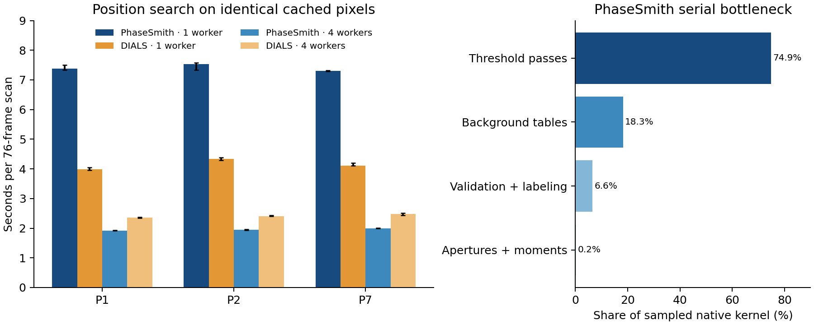

# Fe7C3 position search: PhaseSmith versus DIALS

The position/lattice evidence below is retained. Its original native timing is
superseded by the [exact threshold-loop optimization](threshold-loop-optimization.md),
which includes fresh one- and four-worker DIALS runs.

Measured 2026-10-25 on Apple M4 Pro (14 cores, 48 GiB RAM).

DIALS is 1.74–1.85 times faster with one worker. PhaseSmith scales by
3.67–3.87 times at four workers, compared with DIALS' 1.69–1.80 times;
PhaseSmith therefore takes 19–20% less elapsed time at four workers.
This establishes a serial performance advantage for DIALS on these scans,
not an overall accuracy advantage. The paired position checks favour different
methods on different scans. The third scan also exposes a supercell/indexing
ambiguity that a peak-count comparison would miss.

## Timing and the serial difference

| Scan | PhaseSmith 1 worker | DIALS 1 worker | PhaseSmith 4 workers | DIALS 4 workers |
| --- | --- | --- | --- | --- |
| P1 | 7.373 s | 3.988 s | 1.916 s | 2.366 s |
| P2 | 7.531 s | 4.330 s | 1.948 s | 2.405 s |
| P7 | 7.304 s | 4.113 s | 1.992 s | 2.477 s |



These are medians of three measured runs after one complete excluded warmup.
Whiskers show the observed minimum/maximum, not confidence intervals. Each scan
has 76 images of 2048 × 2048 pixels. Both programs load the same lossless uint16
NumPy arrays from the filesystem cache. The timer includes loading, detection,
and construction of 3D position candidates. Import, initial geometry construction,
file export, and lattice search are outside the timer. Native image/mask hashing
is included; DIALS has no equivalent hashing in this timing. Native workers are
threads calling Rust; DIALS workers are processes. Different detection and
component filters mean this is a workflow benchmark, not an equal-output kernel
comparison. Startup from a fresh app and uncached raw TIFF decoding are not measured.

The full P1 serial profiles locate the difference in native detection:
PhaseSmith spends 6.723 s of 7.578 s in its native extension; DIALS spends
2.833 s of 4.116 s in threshold computation. The profiles have instrumentation
overhead and are separate from the timing medians above. An isolated instrumented
copy of the PhaseSmith detector, using frames 1, 39, and 76 with three measured
repetitions each, attributes 74.9% of kernel time to its two threshold
passes. Background-table builds take approximately 18%, and apertures/moments
less than 1%. Removing intensity summaries cannot close the serial gap.

Both implementations use summed-area tables: local statistics are constant work
per pixel, so this is not evidence of a different asymptotic complexity.
PhaseSmith tests the excess above an annular background (outer radius 8,
inner radius 2), with propagated per-pixel and background uncertainty, in two
passes. This requires outer-minus-inner queries for count, signal, and variance.
DIALS' default extended dispersion method first finds excess local variation,
erodes the exclusion mask, recalculates background without strong regions, then
applies a local mean threshold. The pinned C++ source uses a reusable buffer
with neighbouring count/sum/squared-sum data. Those are concrete implementation
and statistical differences; profiling does not yet isolate their individual
contributions to the speed advantage. Rust alone does not guarantee optimal
machine code or memory access.

DIALS also has serial 3D shoebox construction (0.382 s in the P1 profile), plus
process orchestration and transfer costs. Those stages limit scaling. Their
exact contribution at four workers has not been separately profiled. This
benchmark does not establish a general DIALS scaling limit on longer scans or
other machines.

The next measured target is the native threshold loops: test row-local accesses,
less index/bounds work, and vectorization while preserving arithmetic and support
semantics. Whether these close the gap remains unmeasured. A trial unit-gain,
zero-read-noise variance fast path preserved complete results but showed only a
small timing change overlapping a repeated-original control. It was discarded;
the validated source and installed experimental binary were restored exactly.
No new production detector change or app restart is part of this comparison.

## Position agreement and independent rotation blocks

| Scan | PhaseSmith candidates | DIALS default | DIALS sigma-5 |
| --- | --- | --- | --- |
| P1 | 2125 | 1699 | 1675 |
| P2 | 2421 | 1846 | 1734 |
| P7 | 6436 | 5834 | 5683 |

| Scan | Matched pairs | Median Δxy (px) | 90th percentile Δxy (px) | Paired held-out HKLs | PhaseSmith RMS (Å⁻¹) | DIALS RMS (Å⁻¹) |
| --- | --- | --- | --- | --- | --- | --- |
| P1 | 1232 | 0.139 | 0.408 | 114 | 0.003112 | 0.003243 |
| P2 | 1297 | 0.109 | 0.367 | 148 | 0.003032 | 0.002914 |
| P7 | 3754 | 0.174 | 0.546 | 117 | 0.003518 | 0.003221 |

Matching maximizes one-to-one cardinality before minimizing distance, within
2 pixels in xy and 1 degree in omega. All finite candidates enter the first four
columns. Eight native P1 candidates have nonfinite positions and are explicitly
counted rather than matched. Unmatched candidates are not labelled false peaks.
Single-frame peaks can have identical omega midpoints; separate multiframe-only
agreement is retained in the machine-readable results.

The last three columns compare matched held-out positions assigned the same HKL,
against the *same frozen native training basis*. They therefore compare like
positions, rather than different populations selected by each detector. Repeating
the check with the DIALS training basis mapped into the same lattice setting gives
the same direction of difference. P1 slightly favours native positions; P2 and P7
slightly favour DIALS. These are conditional geometric residuals, not absolute
centroid errors or calibrated precision/recall. Known-cell labels or independent
physical position truth were not supplied.

## Lattice recovery

Both lists were passed through the same PhaseSmith FFT search with identical
geometry, generic axis bounds 1.5–30 Å, grid 256, eight-grain budget,
reciprocal tolerance 0.015 Å⁻¹, seed 842024, and 64 rotated controls. Both axis
signs were tested; the dominant model is chosen by training support. Every fifth
five-frame block is reserved. Tracks crossing different block labels are
excluded, including crossings between adjacent training blocks. Discovery and
fitting use training data only; reserved blocks supply diagnostic validation.
The common input filter requires finite centroids, spans ≤8 frames, and no scan
edge contact. Package-specific flags are retained and are not treated as equivalent.

| Scan | Native volume (ų) | DIALS-list volume (ų) | Native train / held-out | DIALS-list train / held-out |
| --- | --- | --- | --- | --- |
| P1 | 679.07 | 678.95 | 600 / 139 | 562 / 132 |
| P2 | 644.56 | 643.81 | 621 / 174 | 514 / 157 |
| P7 | 671.37 | 2690.19 | 719 / 169 | 676 / 165 |

P1 and P2 recover matching dominant lattice families from either detector.
For P7 the dominant DIALS-list model has approximately four times the native
cell volume. A training-basis-derived integer transformation has determinant 4
and relative basis mismatch 0.00147. This supports an index-four supercell
relationship. Transforming it into the native compact setting is a diagnostic
hypothesis informed by the native solution; it is not an independent DIALS
recovery of that compact cell. Neither inferred cell is proven physically primitive.
All competing and rejected models, reserved support, and rotated-control scores
are retained. Multiple accepted candidates are not proof of multiple physical grains.

DIALS' own indexer, on the same training-only default-DIALS list with fixed
beam/detector/goniometer and no target cell/symmetry, succeeds on P1 and P2 and
reports no suitable lattice on P7. P1 returns one crystal; P2 returns five.
All reverse-axis trials fail. This is one frozen bounded configuration, not a
general claim that DIALS cannot index P7. The own-indexer output is an operational
success check; its individual models have not undergone the paired held-out
assessment above. The common-indexer results distinguish the effect of the
spot list from the effect of switching indexers.

The normal Dioptas/PhaseSmith selection is also retained separately: unflagged,
short tracks with bounded reciprocal spread and means of per-observation q.
It is not silently substituted for the common reported-centroid comparison.
No known cell, UB matrix, indexed reflection file, or structure was supplied to
either search. Earlier analyst familiarity with these scans means this is not
an untouched blind experimental dataset.

## Reproduction and provenance

The raw evidence is in `runs/dials-position-comparison-20261025/` (ignored).
Each case retains explicit omega sidecars, raw TIFF and displayed-pixel hashes,
lossless image arrays, affine geometry, native tables, DIALS PHIL parameters and
reflection files, both axis-sign results, full candidate pools, and matching IDs.
`final-manifest.json` rechecks all 228 raw images, sidecars, and cached pixel arrays,
plus calibration, helper source and installed native binary hashes.
`environment/conda-packages.json` pins all installed DIALS dependencies.
The portable summary is `benchmarks/fe7c3-dials-position-comparison-macos.json`.

The official macOS arm64 installer is DIALS 3.30.1; its internal version function
reports “DIALS 3.30”. The native environment uses Python 3.13.7/NumPy 2.4.1;
DIALS uses Python 3.14.7. DIALS is isolated and is never a PhaseSmith runtime
dependency. The adapter supplies calibrated affine pixels, beam and rotation
models, including checked half-pixel conversions and reciprocal transforms
(errors below 10⁻¹² Å⁻¹ for both axis signs). Zero-count masks agree exactly in
the geometry checks. The same legacy PONI calibration is used for all three scans;
no parallax, non-affine distortion, or recalibrated instrument is inferred.

DIALS retains its default extended-dispersion and size filters, except for an
explicit minimum size of three strong pixels. Native applies that size per 2D
component; DIALS applies it to 3D components. The separate sigma-5 sensitivity
probe changes only `sigma_strong`; it does not make the noise statistics equivalent.
DIALS' upper trusted bound retains saturated uint16 pixels for inspection, while
native marks saturation in its established path. These distinctions matter to
quality interpretation and prevent a claim of identical algorithms.

Replay against the preserved image bundle, using a fresh output directory for
every spot-finding/indexing command:

```sh
# Native Python with the experimental extension:
python benchmarks/rotation_speed_probe.py CASE NEW_OUTPUT --workers 1
python benchmarks/rotation_speed_probe.py CASE NEW_OUTPUT --workers 4
# Isolated DIALS Python:
DIALS_PYTHON benchmarks/dials_position_probe.py find CASE NEW_OUTPUT --workers 1 --repeats 3 --warmup 1
DIALS_PYTHON benchmarks/dials_position_probe.py find CASE NEW_OUTPUT --workers 4 --repeats 3 --warmup 1
# Common indexer and position comparison (outputs must not already exist):
python benchmarks/compare_dials_positions.py index CASE --method native
python benchmarks/compare_dials_positions.py index CASE --method dials-default
python benchmarks/compare_dials_positions.py compare CASE
python benchmarks/compare_dials_positions.py paired CASE
```

The initial export/PHIL-parameter setup failures are retained in explicitly named
attempt directories and excluded from results; neither was a scientific detection
or indexing outcome. The discarded optimization is retained separately with its
binary and exact-output checks. For old nondefault-noise trial records,
`exact_baseline=true` meant self-repeat consistency when no frozen reference was
supplied; the updated timer distinguishes that case explicitly. Primary default
native timings do compare to the frozen complete table and source/mask hashes.
DIALS canonical centroid/bounding-box records repeat bit-for-bit within measured
configurations. Between packages the outputs intentionally differ.

Full reflection intensity integration, completeness, space-group determination,
and a claim of calibrated detection accuracy remain outside this position study.

Validation: 84 targeted detector, rotation and comparison tests pass; formatting
and lint checks pass for the new benchmark helpers. No new production numerical
change is retained. The previously validated native source and binary match the
preserved pre-trial baseline exactly.

Sources: [DIALS spot finding](https://dials.github.io/documentation/programs/dials_find_spots.html),
[DIALS indexing](https://dials.github.io/documentation/programs/dials_index.html),
[official installation](https://dials.github.io/installation.html).
Implementation inspection used the pinned installed `dials/algorithms/image/threshold/local.h`,
`DispersionExtendedThreshold`, with source hashes retained in the run manifest.
