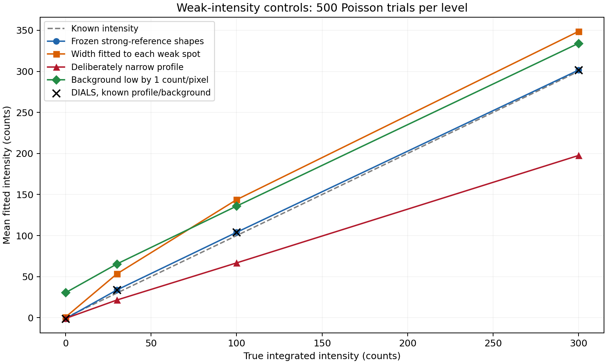
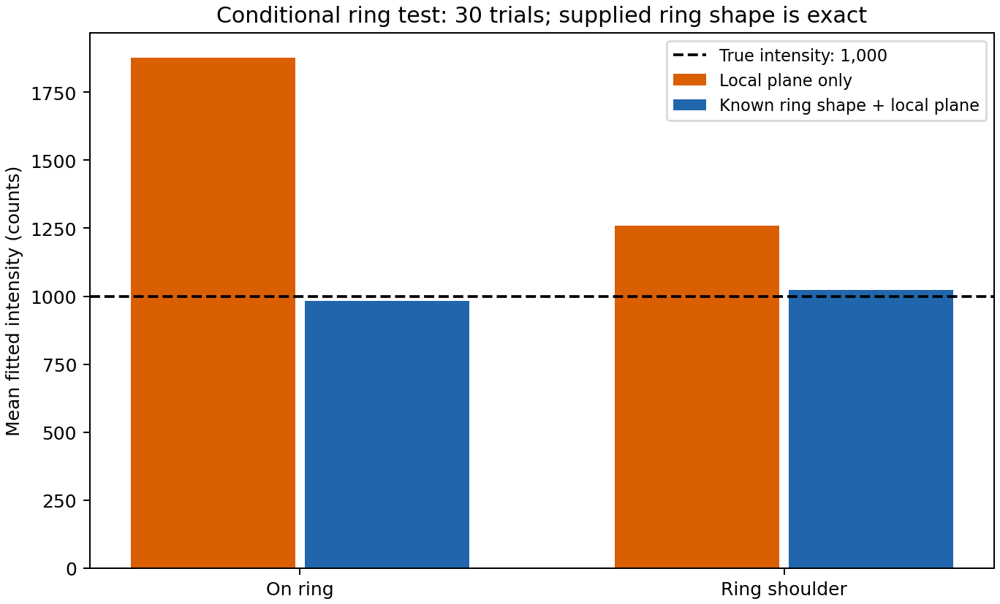
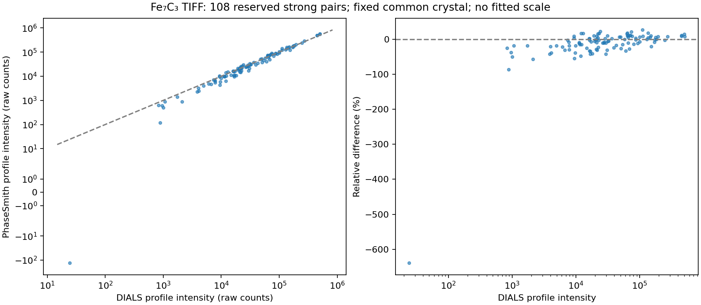
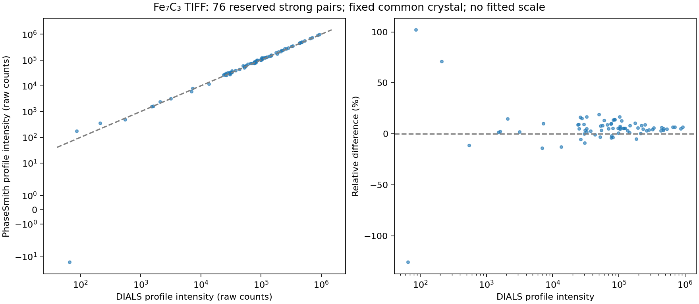

# Fe7C3 profile bias investigation

**Historical research record.** Measurements and conclusions below apply to their
recorded builds. The 3 November 2026 [reconciliation](integration/unfinished-work-reconciliation.md)
retains this evidence and adapts reproduction helpers to the supported API; it
does not rerun or replace the historical scientific comparisons.

25 October 2026. The original −43.8% discrepancy is substantially reduced by
improving shape transfer, but reliable agreement is **not established across both
scans**. P2 passes the declared diagnostic gate; P1 retains large individual
differences. DIALS is a comparator, not physical intensity truth. All results are
local experimental work; nothing was published or pushed.

## What the original discrepancy establishes

The original 40-pair experiment withheld the first 20 images from profile
learning. This tested transfer into a scan region without local teachers.
Replacing native spatial centres with DIALS centres leaves the median at
−43.9%; replacing the background with DIALS's mean changes it to −41.9%.
Broadening only the spatial profile by 1.6 changes it to −20.8%; broadening only
the rocking coordinate by 1.6 gives −36.5%. These are diagnostic interventions,
not a calibration to DIALS or production parameter selection.

The evidence points to spatial shape/support and transfer across the scan as
major contributors. Cutting profile tails and renormalising changes the
intensity convention; a narrow template underestimates broad spots. Neither
centroid replacement nor a background replacement alone explains the original
bias. The controls do not assign an exact causal percentage to each effect.
Full records: `runs/profile-bias-investigation-20261025/interventions.json` and
`local-training-control.json`. Earlier prototypes remain preserved.

## Implemented shape transfer

- Rotate detector footprints into first-order local scattering-plane coordinates;
  integrate the resulting parallelogram exactly over finite profile voxels.
- Retain the signed zeta rocking coordinate and full exposure intervals. Learn
  spatial centroids from strong references; retain predicted Bragg angles.
- Learn a normalised empirical base profile, with an explicit support cutoff.
  This follow-up uses zero additional cutoff inside its finite grid.
- Fit nonnegative mixtures of base, spatially broadened, angularly broadened and
  jointly broadened profiles **to strong references only**. Each component has
  unit finite mass; the total fitted intensity remains signed.
- Transfer median mixture fractions from nearby strong references. Freeze those
  fractions before fitting target amplitudes. Record teachers, fractions,
  coverage, covariance and angular extrapolation flags.

The geometry follows [Kabsch 2010, §§2.3–2.4](https://journals.iucr.org/d/issues/2010/02/00/dz5178/index.html).
It is a local linearised coordinate model, not an assertion that the numerical
operator equals DIALS. Rust evaluates overlap masses and centre derivatives in
the same pass; independent NumPy implementations check the operator and fits.
There is no DIALS runtime dependency. GSAS-II's powder oracle does not cover
these detector-image estimators.

Unrestricted signed combinations were rejected because they can imply negative
profile density. Allowing every weak spot to optimise a physical nonnegative
mixture was also rejected as a measurement default: it introduces selection bias
even though the fitted total is signed. `allow_shape_refinement=True` is an
explicit diagnostic/training escape hatch, not the recommended weak estimator.

## Known counts and weak reflections

3,000 Poisson trials use six true intensities (0, 30, 100, 300, 1,000, 5,000),
four fractional phases and background 82 counts/pixel. No positive-intensity
selection is applied. The generating finite profile is known independently.

| Control at true intensity 100 | Mean recovered intensity |
| --- | ---: |
| PhaseSmith, correct fixed profile | 103.95 |
| DIALS standalone fitter, identical known profile/background | 103.95 |
| PhaseSmith, fractions frozen from separate strong references | 103.95 |
| PhaseSmith, width fitted separately to every weak observation | 143.71 |
| Profile deliberately too narrow | 66.72 |
| Background deliberately underestimated by one count/pixel | 135.90 |

The correct/frozen estimators retain 261 negative measurements among 500 null
trials. PhaseSmith's conditional pull standard deviations are approximately one.
DIALS's standalone uncertainty convention differs; these trials do not validate
its complete pipeline uncertainties. They show no inherent DIALS weak-intensity
boost when its supplied profile and background are correct. Remaining real-data
weak differences cannot be assigned to DIALS bias from relative ratios alone.

Files: `runs/profile-bias-investigation-20261025/known-intensity/`, including both
fitters' arrays, input fixture and deterministic drivers in `benchmarks/`.

## Background, CCD identity and CrysAlisPro

The integration starts from **raw TIFF counts**. It subtracts a fitted local
background plane inside the estimator; no whole-image omega-background product
is used. Conditional plane covariance is propagated. The readout gain/noise
calibration is still incomplete: gain 1 and read-noise 0 are assumptions, not a
measured detector response.

The private TIFF header identifies marccd v0.18.7 and a cooled CCD (serial 85).
The external DIALS adapter incorrectly labelled these images PAD in the original
probe. The follow-up explicitly uses CCD. This changes background defaults and
some outliers, but its median effect is about 1%, insufficient to explain 43.8%.
The hardware gain setting is not a photons-per-ADU calibration. Header wavelength
fields are not substituted for the matching 0.3100 Å PONI. Each source image is
flipped vertically exactly once, as in the preserved common pixel adapter. The
older 0.414915 Å Fit2D/MAR setup remains outside this comparison.

Background choices must follow statistics and background shape. A robust
Poisson model addresses low-count clipping bias; it does not automatically model
diamond or powder rings. See [Parkhurst et al. 2016](https://journals.iucr.org/j/issues/2016/06/00/ap5008/index.html).
A reusable background template fitted locally is a published way to handle
rings, conditional on template stability: [Parkhurst et al. 2017](https://journals.iucr.org/m/issues/2017/05/00/hi5646/index.html).

A separate synthetic ring control supplies the **known generating ring shape**.
For true intensity 1,000, a plane alone returns mean 1,876 on the ring and 1,259
on its shoulder; known-ring-plus-plane returns 982 and 1,024. Clear flags do not
guarantee a sufficient background model. This is conditional evidence motivating
a future ring-aware model, not a production implementation or real-data result.

Rigaku documents smart background, profile rejection and joint fitting of twin
components in [SMX004](https://rigaku.com/products/crystallography/x-ray-diffraction/application-notes/smx004-using-crysalispro-to-elucidate-twinned).
[SMX023](https://rigaku.com/hubfs/2024%20Rigaku%20Global%20Site/Resource%20Hub/Applications%20Library/PDF/145532326025.pdf?hsLang=en)
also describes comparing profile/background settings and treating absorption and
weighting separately. These public notes do not specify the complete proprietary
equations or prove which settings generated the archived CrysAlis reduction.
There is no single published universal best method for every detector and DAC
background. Modern [DIALS supports small-molecule processing](https://dials.github.io/documentation/tutorials/small_molecule_tutorial.html);
its biological origins do not invalidate the count model, but defaults and
corrections matter.

## New reflection-family holdout

This is a **changed protocol**, not the same 40-pair before/after benchmark.
Twenty percent of absolute-HKL sign families, chosen by a fixed SHA256 rule, are
withheld from both base-profile and width-fraction learning in both programs.
Independent strong references may now cover the entire scan. Geometry predates
the intensity split. These data were inspected during development, so this is
not a fresh blind validation.

Both scans contain 76 TIFFs. The PONI SHA256 is
`022575d4d9b4463c2cab6c07c4f719a900b2fe29721c535ce5d063028702b8e7`.
P2 uses frozen indexed crystal 0, the physically plausible Fe7C3 candidate;
four other indexed alternatives are not assumed to be genuine domains.
All 3,274 P1 / 3,126 P2 native predictions match DIALS by HKL and crossing with
maximum detector differences below 1.2e-12 pixels. Raw unscaled profile counts
are compared, without LP, absorption or matching-scale adjustment.

Primary selection requires pre-profile sum >5 sigma, clear input-quality flags,
no angular shape extrapolation and at least 99% recorded profile mass in both
programs. It does not select low profile residuals. Weak/negative and failed
measurements remain in the complete output. Very large relative errors near
zero are not an adequate weak-bias statistic.

| Primary held-out strong measurements | P1 | P2 |
| --- | ---: | ---: |
| Pairs | 108 | 76 |
| Median (PhaseSmith − DIALS) / abs(DIALS) | −5.91% | +5.53% |
| Median absolute relative difference | 11.21% | 5.77% |
| 90th percentile absolute difference | 38.96% | 15.00% |
| Pearson correlation | 0.99644 | 0.99969 |
| Declared agreement gate | **fails** | **passes** |

The gate is at least 30 pairs, absolute median bias <=10%, p90 absolute
difference <=30% and correlation >=0.95. A preceding conservative implementation
also flagged hypothetical *inactive* mixture components. Correcting that mask to
use the actual frozen profile admits more P1 measurements and exposes its wider
tail; the earlier smaller, passing subset is not the final result.

Runs: `runs/frozen-profile-validation-P{1,2}-final-20261025/` and
`runs/frozen-DIALS-CCD-P{1,2}-20261025/`. Each retains protocols, full measurements,
matched CSV/arrays, learned models, teacher IDs and source snapshots. Native base
profiles use 101 / 296 references and width learning uses 49 / 131 teachers.

## Structural checkpoint and limits

The archived `fe7c3d_p01.cif` was introduced **only after integration**. Its SHA256
is `e2972697f7741a82832c7af1400d7311d53eaddfbd314c3896cae1bb3026beb9`.
A native/CIF axis permutation (k,h,l) aligns the cell. Atomic positions remain
fixed; intensity scale and one common displacement shift are fitted on training
families only, with identical pre-profile weights for both intensity sets.

On 108 held-out P1 observations, amplitude R1 is 0.272 for PhaseSmith and 0.232
for DIALS. Perturbed-coordinate controls give 0.821 / 0.814; Fe-only controls
give 0.286 / 0.253. The correct structure is favoured over scrambled positions,
but the displacement parameter reaches its lower bound in both fits. Assumed
polarisation is used for LP, with no DAC absorption or frame scaling. This is
neither an ab-initio solution nor a full atomic refinement, and it does not
certify carbon coordinates or absolute intensities. Full correction, symmetry,
solution and refinement remain necessary before choosing the scientific default.
See `structure-checkpoint.json` and `benchmarks/structure_validation_checkpoint.py`.

## Speed and method policy

Same 76 cached pixel arrays, one worker, warm file cache, release native build;
post-indexing workflow timings exclude imports, indexing and exports. DIALS
includes reference preparation and integration; native includes background/sample
preparation, both learning stages and fitting. Supports and algorithms differ,
so this is a workflow comparison, not a matched kernel benchmark.

| Workflow | Seconds |
| --- | ---: |
| PhaseSmith summation with the same collection/background windows | 2.13 |
| PhaseSmith learned profiles, complete | 19.06 |
| DIALS CCD integration, complete | 4.49 |

Native profile time comprises 2.59 s preparation, 2.39 s base learning, 1.24 s
strong-reference shape learning and 12.84 s fitting. The new workflow is about
4.2 times slower than DIALS here. Three serial fitting replays take
12.58–12.61 s and reproduce every value/flag bitwise. Eliminating weak spots from
the shape-training pass and skipping exactly zero mixture components removed
unnecessary work without an approximation or changed results.

Keep a small explicit method set: signed summation as the fast inspection
baseline, fixed learned profiles as an experimental alternative, and strong-only
learned width variants as an opt-in extension. Keep background choice separate
and record the selected method/settings. Preserve both sum and profile outputs;
do not silently choose whichever gives a positive result or agrees with DIALS.
One recommended default should follow known-count controls, held-out repeatability
and downstream structure refinement. No universal profile default is justified
by the two scans yet. A ring-aware model needs independent validation before
being offered as a routine option.

## Verification and reproduction

Rust formatting, all-feature workspace clippy and workspace tests pass.
Python: **1,408 passed, 11 skipped, 34 deselected**. Tests cover reflected/sheared
pixel footprints, finite mass/moments, analytical centre derivatives, dense
covariance references, nonnegative shapes, signed null/weak intensities and
strong-to-weak transfer without target-pixel leakage. A fresh experimental wheel
installed into Dioptas reproduces the entire P1 preparation, learned model and
fit bitwise; it does not depend on the research checkout being importable.

Drivers: `investigate_profile_bias.py`, `known_intensity_control.py`,
`dials_known_intensity_probe.py`, `ring_background_control.py`,
`frozen_profile_validation.py`, `dials_integration_probe.py`,
`compare_3d_profiles.py`, `benchmark_3d_profiles.py`, `profile_workflow_timing.py`
and `structure_validation_checkpoint.py` under `benchmarks/`. DIALS drivers run
in the isolated DIALS environment; normal API/benchmark drivers use PhaseSmith
and NumPy, with image/plot or SciPy dependencies only where needed by the probe.
