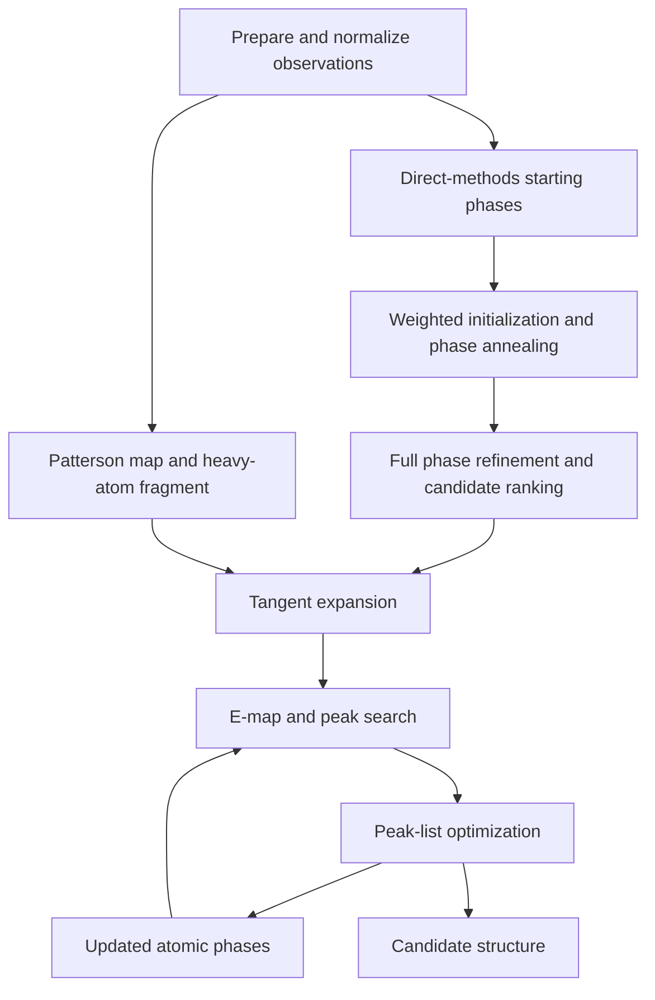
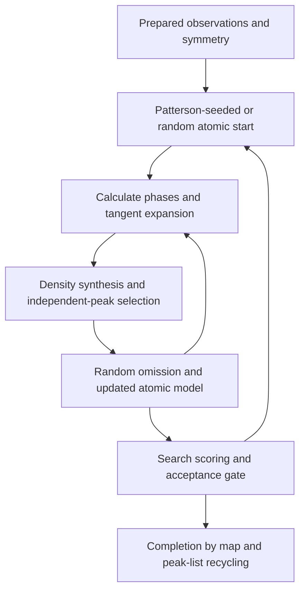

# General SHELXS and SHELXM/SHELXD method review

29 October 2026. Static decompilation and method tracing only. No new PhaseSmith
solver behavior or performance result is introduced.

## What was decompiled

- **SHELXS 2024/1**, installed macOS x86-64 executable, SHA-256
  `342b02f713384bf264f0e8eeb2ba1f1e900a24423558b482d6338cdc6a8d5269`.
  All 55 selected named application/support entry points produced Ghidra output,
  including MAIN__, sx2a–sx2j and the sx/sv helpers: 33,183 routine-output lines.
  Known compiler/libm entry wrappers and the later Fortran runtime were excluded.
  The symbol interval is a practical selection, not proof of a complete program.
- **SHELXM/SHELXD 2013/2**, supplied Windows x86-64 executable, SHA-256
  `9b331fef9101abb840ed4368e67baa9ec8aff0871da9f5ab9e1e2cc164c8590d`.
  The earlier 40 address-selected exports remain available. Eight central entries
  were re-exported with analyst labels to make their calls easier to follow.
  These eight views are not additional independent recovered algorithms.
  `trace_` names use retained Fortran traceback metadata; `inferred_` labels are
  analyst interpretations. This is the supplied XM/SHELXD family executable,
  not a separately obtained historical SHELXM build.

Raw pseudocode, input snapshots, scripts, status, symbol/call records and hashes
remain outside the repository:

- `/Users/clemens/Codex/shelxs-binary-audit-2026-10-29/`
- `/Users/clemens/Codex/shelxm-shelxd-audit-2026-10-29/general-review/`

All selected decompilations returned `complete=true`. That reports the decompiler's
completion, not correct reconstruction of every type, argument or source loop.
Optimized Fortran calling conventions, packed arithmetic and overlapping compiler
fragments remain important limits. Some apparent infinite loops in SHELXS MAIN__
include termination paths the decompiler has not modeled as non-returning; they
are not evidence that the actual program never finishes. No pseudocode was copied
or translated into PhaseSmith, and no new numerical experiment was run.

## The general strategy

These programs combine different ways of finding useful phases, then expand a
partial atomic model. E values are normalized diffraction amplitudes; they reduce
the overall resolution dependence of the scattering. A phase search on those
values is distinct from the later refinement of coordinates and displacement
tensors against the observations.

SHELXS exposes three phase-search stages, INIT, PHAN and TREF, followed by tangent
expansion and E-map recycling. Triplet relationships guide phase updates;
negative quartets help reject overly consistent false solutions. Annealing adds
controlled perturbations before ordinary refinement. Starting atoms can instead
supply phases through TEXP. These documented roles help interpret the binary,
without making every inferred array a recovered equation. See the author's
[SHELXS command reference](https://www.juergenkopf.de/doc/shelxs/reference.html)
and [SHELX-97 manual](https://ccc.bc.edu/content/dam/bc1/schools/mcas/Chemistry/pdf/research/xray/shelx-97.pdf).

Conceptual SHELXS routes (not a literal listing of every branch):

The key distinction is that good reciprocal-space statistics alone do not make
a structure. After phase search, an atomic map and its peak list must also become
self-consistent. Patterson and direct-methods routes can meet at partial-structure
expansion rather than functioning as unrelated complete solvers.

SHELXD places repeated reciprocal/real-space alternation directly inside its
initial search. It can start from sampled Patterson-consistent arrangements or
random atoms, refine phases, synthesize density, select peaks and omit some
before continuing. A later completion stage follows. This is the published
Shake-and-Bake-style distinction; see
[Sheldrick (2008), section 2.3](https://journals.iucr.org/a/issues/2008/01/00/sc5010/index.html).

## What can be followed in SHELXS itself

References below name the external `.c` exports. Routine names are retained
symbols; the physical descriptions additionally use diagnostic text and call
order. The default-mode interpretation is stronger than a claim that all options
follow exactly this route.

| Export | Direct binary evidence |
|---|---|
| `_MAIN__.c`, lines 514–593 | Dispatches sx2a–sx2e, then revisits sx2f/sx2g and the later peak/Patterson routines under mode flags |
| `_sx2a_.c` | Instruction processing for the alternative modes and their controls |
| `_sx2b_.c` / `_sx2c_.c` | Observation/working-array preparation and reflection/phase selection; sx2c includes fixed-phase handling and failure diagnostics |
| `_sx2d_.c` | Triplet-list preparation diagnostics for the selected phase-refinement sets |
| `_sx2e_.c`, lines 1021–1485 | Negative-quartet preparation, memory caps, parallel phase-set bookkeeping and separate Ralpha/Nqual/Sigma-1/CFOM diagnostics |
| `_sx2e_.c`, lines 1760–1800 and 3270–3283 | Separate initial tangent, annealing and full-refinement cycle branches, with an evolving annealing-control variable |
| `_sx2f_.c`, lines 578–592 and 2967 onward | Tangent expansion, memory-limited relation search and later peak-list optimization with an E-based residual report |
| `_sx2g_.c`, lines 351–465 and 2063–2083 | Separate Patterson, super-sharp Patterson and E-Fourier map/peak-search modes |
| `_sx2h_.c` / `_sx2i_.c` / `_sx2j_.c` | Atomic peak records, superposition-peak handling and Patterson validation/interpretation including PATFOM |

This reveals a staged search rather than one universal figure of merit. Different
statistics are used to select phases, judge a Patterson hypothesis and improve
an atomic peak list. The presence of NQR/Nqual code and diagnostics is explicit;
the exact probabilities and every quartet eligibility rule have not been
independently reconstructed or tested.

Weak observed reflections carry information in a quartet test. They must not be
confused with unmeasured coefficients or systematic absences. An implementation
that silently fills all missing data with weak observations could make apparently
convincing phase statistics without new experimental evidence. This is a design
implication of the method, not a claim that the inspected binary does so.

## The broader SHELXM/SHELXD view

The new named core exports make the earlier address-based inspection easier to
navigate. MAIN__ setup and its parallel worker call the search routine SX1C and,
conditionally, SX1E. SX1C calls a large numerical worker with Patterson/PSUM,
peak/cycle and integer phase-index machinery. Its weighted pair sums use indices
modulo 360 and normalize resulting coefficient pairs. SX1C also accumulates
weighted correlation statistics before the separate stage. This supports the
published division between initial search and completion, while leaving some
array identities and branch conditions unresolved.

The official [SHELXD manual](https://shelx.uni-goettingen.de/shelxd_sm_keywords.php)
explains FIND, PLOP, TANG, WEED and PATS: bounded tangent expansion, omission,
sampled Patterson starts and subsequent peak-list deletion. FIND uses a supplied
peak-count estimate. The native HKLF 4 route applies to ordinary structure
solution; the anomalous-scatterer workflow is another use of the program.

A source-level gap matters here: I have not recovered an explicit SHELXS-style
negative-quartet stage in the SHELXD exports. Its presence in SHELXS should not
be attributed to every SHELX program merely because all use phases and maps.
Likewise, inferred helper labels in the named XM view are not newly discovered
original routine names.

## Consequences for PhaseSmith

The inspected PhaseSmith code already has Patterson superposition starts,
count-free atomicity masks, random omission, symmetry recovery, recycled maps,
density-guided orbit assignments and full constrained refinement. Three distinct
extensions emerge from the general comparison:

1. **A direct-methods phase engine.** Triplet-based phase updates and optional
   annealing would be an additional phasing strategy, not the same operation as
   the present hybrid Fourier magnitude update or supplied-symmetry averaging.
2. **An explicit false-solution test.** The SHELXS quartet machinery suggests
   testing stronger phase-consistency diagnostics on difficult datasets, with
   careful observed/missing-data separation. Its benefit and robustness require
   independent numerical verification.
3. **Cheaper model completion.** Screen many peak/orbit removals with frozen
   phase sums before promoting a small set to full coordinate/ADP refinement.
   This targets the repeated-refinement cost already measured in PhaseSmith.

The general lesson is to prepare reusable data, explore many inexpensive
hypotheses, and apply increasingly costly checks. It is not evidence to replace
PhaseSmith's final original-observation validation with a historical phase score.
SHELX input composition and peak-count estimates must also remain distinct from
PhaseSmith's inferred full-cell counts. Nothing here establishes that a new
algorithm is faster, more general or more accurate before a controlled comparison.
