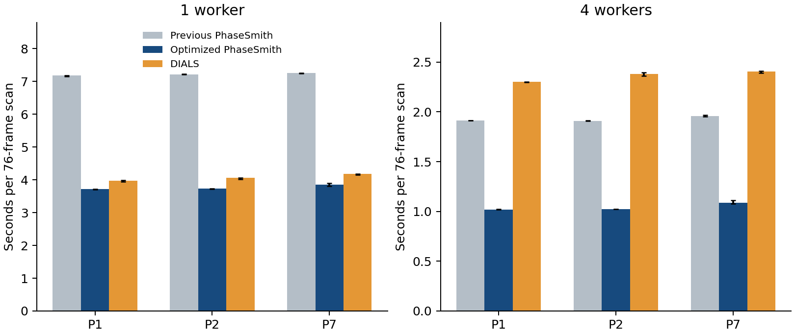
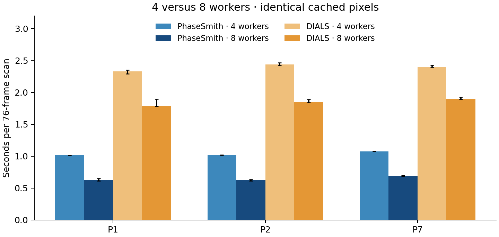

# Threshold-loop optimization with exact results

Measured 2026-10-25 on Apple M4 Pro (14 CPU cores, 48 GiB RAM), release-mode
experimental-spots builds. This is an execution optimization of the existing
annular threshold equations. There is no new detector statistic, intensity
integration, cell search, worker policy, or runtime dependency.

The Dioptas consumer subsequently added a shared startup CPU/memory policy.
Its frame default is now Auto (the common CPU allowance, capped on macOS by
detected performance cores, with memory/task limits). The previous eight-worker
feature cap is removed; this M4 Pro permits ten workers. The measurements below
retain explicit worker counts and do not establish a ten-worker speedup.

## Measured result

| Scan | Previous 1 worker | Optimized 1 worker | DIALS 1 worker | Previous 4 workers | Optimized 4 workers | DIALS 4 workers |
| --- | --- | --- | --- | --- | --- | --- |
| P1 | 7.174 s | 3.711 s | 3.967 s | 1.915 s | 1.019 s | 2.301 s |
| P2 | 7.216 s | 3.725 s | 4.056 s | 1.910 s | 1.023 s | 2.383 s |
| P7 | 7.249 s | 3.847 s | 4.179 s | 1.959 s | 1.086 s | 2.403 s |

Compared with the preserved current implementation, the optimized position
search is 1.88–1.94× faster with one worker and
1.80–1.88× faster with four workers.
Against fresh DIALS runs, its median elapsed time is lower on all three scans:
DIALS/native ratios are 1.07–1.09× at one worker and
2.21–2.33× at four workers.
These are local desktop timings, not cross-platform speed guarantees.



Each bar is the median of three complete runs after one excluded full warmup;
whiskers show observed minimum/maximum, not confidence intervals. Baseline,
candidate and DIALS run sequentially on the same cached lossless image arrays,
with workflow order reversed for the four-worker comparison. Each scan has
76 frames of 2048² pixels. The baseline is the explicitly preserved pre-edit
package and binary, not a rebuilt moving branch. Each subprocess asserts the
loaded native binary hash. The one- and four-worker searches use the same
native gain/read-noise/saturation and detector/linking options as before.

The clock includes image loading/masks, detection, source/mask fingerprinting
in native, and construction of linked 3D positions. Initial imports/geometry,
file export, and lattice indexing are excluded. Native workers are threads;
DIALS workers are processes. DIALS has no equivalent source hashing here.
DIALS is the same isolated 3.30.1 arm64 distribution as the previous comparison
(internally reports DIALS 3.30), with the same frozen PHIL configuration and
explicit affine geometry. Neither algorithm is tuned for these new timings.
The two packages have different spot statistics/component filters, so this is
a workflow comparison rather than an identical-output kernel benchmark.

## Eight-worker follow-up

Fresh four/eight-worker runs use the exact same optimized binary and frozen
DIALS configuration, with one full warmup and three measured repeats for each
configuration. Both workflows run sequentially on the same cached pixels;
workflow order is reversed at eight workers. These controls are separate from
the earlier one/four-worker table above.

| Scan | PhaseSmith 4 | PhaseSmith 8 | DIALS 4 | DIALS 8 |
| --- | ---: | ---: | ---: | ---: |
| P1 | 1.015 s | 0.626 s | 2.329 s | 1.793 s |
| P2 | 1.018 s | 0.631 s | 2.438 s | 1.843 s |
| P7 | 1.073 s | 0.690 s | 2.402 s | 1.892 s |

Eight workers reduce PhaseSmith elapsed time by 36–38% versus four
on this Mac. DIALS also improves, by 21–24%.
At eight workers, DIALS/native elapsed-time ratios are 2.74–2.92×.
The benefit is sublinear: loading, fingerprints, linking and pool overhead remain.
Eight frame workers permit twice as many simultaneous detector workspaces as
four; this comparison does not measure aggregate resident memory.



Every native timed repeat remains byte-identical to the frozen table and
source/mask hashes. A separate eight-worker replay also matches the complete
per-frame detection digest and all final arrays on both realistic synthetic
workloads and P1/P2/P7. DIALS' full exported fields match its frozen records
after canonical ordering. No production kernel or default worker setting was
changed for this follow-up.

Reproduce with the same benchmark command plus
`--workers 4 8 --methods candidate dials`. Raw evidence is retained in
`runs/threshold-eight-workers-20261025/`; portable results are appended as
`eight_worker_followup` in `benchmarks/threshold-loop-performance-macos.json`.

## Implementation and numerical contract

For each pixel the unchanged detector uses:

    B = sum(D in background ring) / n
    V_B = sum(V in background ring) / (n*n)
    strong = valid and (n >= minimum_background)
             and (D - B > absolute_threshold)
             and (D - B > sigma_threshold * sqrt(V_pixel + max(V_sum,0)/(n*n)))

The background ring is the clipped inclusive outer square minus the inclusive
inner square; defaults remain outer radius 8 and inner radius 2. There are
exactly two passes. The second excludes first-pass strong pixels from the
background only. Absolute and noise comparisons remain strict. Rectangle
subtractions retain `e - c - d + a`, outer-minus-inner, and the same division,
multiplication, square-root and comparison order within each pixel.

Interior columns now use pre-sliced corner streams with fixed offsets. Three
row-sized scratch buffers hold background counts, sums and variance sums.
Regular independent passes replace a large branch-heavy pixel loop. The final
row loop evaluates the threshold predicates together and gates masked or
insufficient-background lanes explicitly. Supplied-variance and estimated-noise
paths are selected outside that loop. Generated arm64 code contains two-lane
f64 vector divisions and square roots. No reassociation, approximate reciprocal,
fast-math flag, unsafe access, or hand-written architecture-specific code is used.

Clipped columns retain the scalar calculation, and an image too narrow for an
interior uses that path throughout. Clipping in the vertical direction is
unchanged. The scratch storage at width 2048/default radius is 48,768 bytes per
active detector; it scales with row width, not image area. Background table
construction, connected-component ordering, extraction values/uncertainties,
centroids, adjacent-frame linking and worker orchestration are unchanged.

The independent direct-sum Python reference remains unchanged because the
equations and statistical behavior have not changed. Existing derivative,
area/moment and noise tests continue to apply; there is no new profile term
requiring an analytical derivative. GSAS-II's powder oracle does not cover
image thresholding.

## Equality and validation

The complete native scientific records match the preserved baseline byte for
byte, including dtype, shape, NaNs, bounding boxes, values, flags, observation
records, angular ranges and source/mask hashes. Per-frame spot values/boxes/flags,
rejected-small-component counts and noise conventions are also compared through
an ordered digest. This passes at one and four workers for both realistic
synthetic grids (32 × 512² and 16 × 2048²) and all three Fe7C3 scans.
P1/P2/P7 retain 2,125/2,421/6,436 position candidates.

A separate preserved-binary check covers 60 deterministic nondefault cases,
three frames per case, at one and four workers: clipped/narrow supports,
inner/outer radii including 0/1 and 7/128, masks with NaNs, fully masked frames,
saturation, negative corrected counts and nondefault gain/read noise. It also
checks supplied-variance per-frame detection. All 1,320 stored arrays are
byte-identical. Additional independent-reference tests straddle the interior
width transition and check exact/adjacent floating-point absolute and noise
threshold boundaries in scalar and vector lanes. DIALS' full exported fields
also match its frozen previous results after canonical ordering.

Validation passes: cargo fmt; workspace/all-target/all-feature clippy without
warnings; 380 Rust tests/doctests; 1,248 Python tests (11 unavailable external-input
skips and 34 external/real-data deselections); and helper formatting/lint checks.
Scientific equality excludes code/binary provenance hashes, which correctly
change for the optimized implementation. No golden file is regenerated and no
tolerance is loosened. The prior position/lattice assessment remains applicable
because native outputs are unchanged; no new claim of absolute detection
accuracy, primitive cells or intensity completeness follows from faster execution.

## Reproduction

The local run `runs/threshold-loops-20261025/` retains the pre-edit package,
source and binary manifests; candidate builds; rejected intermediate variants;
full record comparisons; compiler assembly; test logs; all raw timing repeats;
and the final manifest. The portable result is
`benchmarks/threshold-loop-performance-macos.json`.
The original common-pixel bundle and pinned DIALS environment remain in
`runs/dials-position-comparison-20261025/`.

```sh
python benchmarks/benchmark_threshold_loops.py COMMON_PIXEL_BUNDLE NEW_OUTPUT \
  --baseline-site PRESERVED_PACKAGE_PARENT \
  --dials-python ISOLATED_DIALS_PYTHON
```

`NEW_OUTPUT` must not exist. The helper performs all six configurations per scan,
asserts native results against the frozen tables, checks DIALS exports against
its frozen records, and saves logs/results after each scan. Intermediate
row-slice-only (~6.7 s P1 serial) and staged-but-branching (~6.2 s) probes are
retained separately; they are not mixed into the final medians. An initial
optional raw-TIFF equality replay lacked Pillow in the core environment; it
was rerun successfully in the existing Dioptas environment with the same
candidate loaded explicitly. That setup failure is retained and excluded.

See [the original position and lattice comparison](fe7c3-dials-position-comparison.md)
for detector/filter differences and scientific limitations.

The run's `wheels/` directory contains a local experimental wheel whose native
binary hash matches the benchmarked binary exactly. The running Dioptas session
has not been replaced or restarted; using this build there requires the local
experimental package update followed by a restart.
