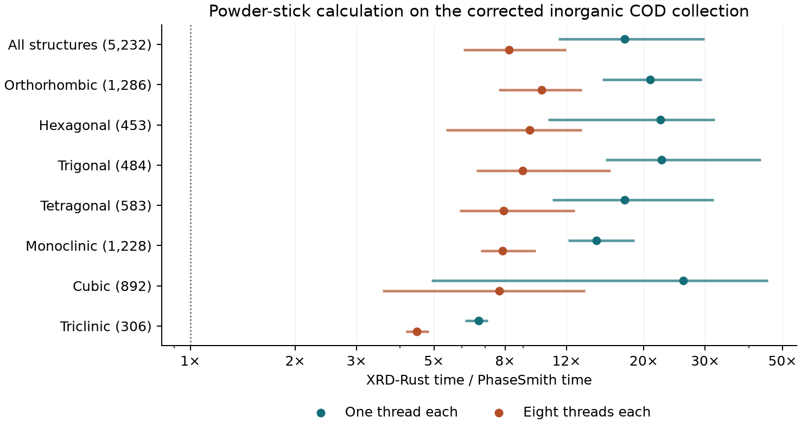

# PhaseSmith versus XRD-Rust

The [full comparison](#full-speed-comparison-21-november-2026) measures both libraries. A subsequent [PhaseSmith-only benchmark](#faster-systematic-absence-checks) measures the additional extinction optimization.

## Full speed comparison, 21 November 2026

PhaseSmith 0.8.5 at `311b7b9` calculated powder sticks **10.75× faster with
one thread each and 5.13× faster with eight threads each** than XRD-Rust
0.3.5 on the median qualifying inorganic COD structure. The benchmark uses
the standard XRD-Rust SIMD calculator described in the [XRD-Rust paper](https://journals.iucr.org/j/issues/2026/04/00/hat5023/index.html).

Both release builds ran on an Apple M4 Pro with Python 3.13.7 and macOS 26.6.2.
The real-structure timings cover reflection generation, structure factors and
powder sticks over 2–60° in 2θ at 0.71073 Å, using the same prepared neutral-atom
model, occupancies and zero displacements. Each thread setting received one
warm-up and three measured calls in rotating order. CIF parsing was timed
separately. The comparison matches peaks within 0.00001° and requires
intensity correlation ≥0.999 and matching of all peaks reaching 0.1% of either
pattern’s maximum. The tables use medians of per-file timing ratios.

[Download the per-file results, raw timing repetitions, input checksums and environment](downloads/2026-11-21-xrd-rust-benchmark.zip).

### Corrected inorganic collection

| Threads PS / XR | PhaseSmith median (ms) | XRD-Rust median (ms) | Median paired speedup | PhaseSmith faster | Summed PS / XR time (s) | Summed-time speedup |
|---|---:|---:|---:|---:|---:|---:|
| 1 / 1 | 1.772 | 20.247 | 10.75× | 5,223 / 5,232 | 21.0 / 385.4 | 18.32× |
| 8 / 8 | 1.661 | 8.593 | 5.13× | 5,215 / 5,232 | 15.4 / 109.9 | 7.14× |
| 2 / 8 | 1.769 | 8.593 | 4.92× | 5,231 / 5,232 | 18.0 / 109.9 | 6.12× |
| 1 / 8 | 1.772 | 8.593 | 4.71× | 5,231 / 5,232 | 21.0 / 109.9 | 5.23× |

Both calculators produced patterns for 5,319 of 5,552 structures. The primary comparison covers the 5,232 that passed the original cross-library agreement criteria. The 87 excluded timed pairs are exactly the previously investigated entries. Including them gives median speedups of 10.76× at one thread each and 5.12× at eight. The remaining 233 files comprised 91 strict reader rejections, 104 cell-only inputs and 38 shared-model construction failures. Of the 87 disagreements, 82 were traced to omitted reciprocal points in XRD-Rust and five to the neutral-tin scattering factor.

| Crystal system | Qualifying structures | One thread each | Eight threads each | PhaseSmith faster at eight |
|---|---:|---:|---:|---:|
| Triclinic | 306 | 5.69× | 3.62× | 306 / 306 |
| Monoclinic | 1,228 | 10.80× | 5.53× | 1,228 / 1,228 |
| Orthorhombic | 1,286 | 13.43× | 6.24× | 1,285 / 1,286 |
| Tetragonal | 583 | 9.60× | 4.50× | 583 / 583 |
| Trigonal | 484 | 12.11× | 4.87× | 484 / 484 |
| Hexagonal | 453 | 15.35× | 6.54× | 453 / 453 |
| Cubic | 892 | 8.32× | 2.67× | 876 / 892 |



Dots mark median paired speedups and horizontal lines span the middle 50% of structures. The dotted line marks equal speed.

The earlier full run at 98bd223 measured 5.64× and 2.77× at one and eight threads each. Cross-run timing ratios can vary with machine conditions. The separate alternating old/new build benchmark tested the optimization directly. All per-file errors and numerical agreement metrics reproduced the original full comparison to its verification tolerance. [Paired optimization measurements](#corrected-inorganic-cod-collection-november-2026)

### How much does threading help PhaseSmith?

For each structure, divide its one-thread median calculation time by its
two- or eight-thread median. This isolates PhaseSmith’s threading gain.
The last two columns sum one median-timed calculation per file, so expensive
structures contribute their full cost.

| Qualifying structures | Files | Median 1 / 2 threads | Median 1 / 8 threads | Total at 1 thread (s) | Total at 8 threads (s) |
|---|---:|---:|---:|---:|---:|
| Inorganic, 1–32 expanded sites | 1,985 | 0.98× | 0.91× | 1.75 | 1.83 |
| Inorganic, 33–128 sites | 2,577 | 1.03× | 1.09× | 8.11 | 6.87 |
| Inorganic, 129+ sites | 670 | 1.17× | 1.33× | 11.17 | 6.69 |
| All qualifying inorganic | 5,232 | 1.01× | 1.02× | 21.03 | 15.39 |
| Original mixed COD | 97 | 1.35× | 1.81× | 5.77 | 2.32 |

Eight threads saved a median 0.034 ms per inorganic structure and were faster
on 2,857 of 5,232. The total fell by 26.8% (1.37× speedup). The smallest
structures tended to take longer with eight threads. Structure factors use the
thread policy, while reflection generation and stick preparation still contribute
serial work. These size bins describe this dataset and machine.

### Original mixed COD sample

The separately frozen 100-file panel produced 100 timed patterns and 97 passing pairs. It uses the original Gemmi-based common inputs, including the documented correction to COD 4002001.

| Threads PS / XR | PhaseSmith median (ms) | XRD-Rust median (ms) | Median paired speedup | PhaseSmith faster | Summed PS / XR time (s) | Summed-time speedup |
|---|---:|---:|---:|---:|---:|---:|
| 1 / 1 | 16.939 | 213.644 | 14.28× | 97 / 97 | 5.8 / 113.9 | 19.73× |
| 8 / 8 | 8.992 | 58.615 | 7.78× | 97 / 97 | 2.3 / 25.8 | 11.12× |
| 2 / 8 | 12.494 | 58.615 | 5.85× | 97 / 97 | 3.8 / 25.8 | 6.77× |
| 1 / 8 | 16.939 | 58.615 | 4.31× | 97 / 97 | 5.8 / 25.8 | 4.48× |

### Synthetic controls

The three P1 controls use the original public-API synthetic driver, its original positions and normalized-intensity check, two warm-ups and case-specific repetition counts. The reported speedup divides the median times within each case.

| Case | Atoms | One thread each | Eight threads each |
|---|---:|---:|---:|
| Small | 8 | 4.73× | 4.54× |
| Medium | 64 | 5.93× | 3.51× |
| Large | 256 | 5.57× | 2.49× |

### CIF reading

These timings compare PhaseSmith strict CIF import with the pymatgen reader used to supply XRD-Rust. Times and speedups use entries for which both readers returned atom sites. PhaseSmith represents asymmetric sites and symmetry, while pymatgen expands the cell.

| Collection | Attempted | Both had atoms | PhaseSmith median (ms) | pymatgen median (ms) | Median paired speedup |
|---|---:|---:|---:|---:|---:|
| Corrected inorganic | 5,552 | 5,218 | 0.686 | 1.305 | 1.82× |
| Original mixed COD | 100 | 98 | 1.028 | 5.393 | 5.31× |

## Faster systematic-absence checks

A subsequent paired benchmark compared the build used above (`311b7b9`) with `1fe00d7` on the same M4 Pro. The generator prepares fractional translations once and tests for systematically absent reflections with exact integer arithmetic. The [symmetry documentation](symmetry-reflections.md) gives the derivation and fallback for other origins.

| Crystal system | Qualifying structures | Median improvement at 1 thread | Median improvement at 8 threads |
|---|---:|---:|---:|
| Triclinic | 306 | 1.17× | 1.24× |
| Monoclinic | 1,228 | 1.36× | 1.48× |
| Orthorhombic | 1,286 | 1.53× | 1.64× |
| Tetragonal | 583 | 1.79× | 1.82× |
| Trigonal | 484 | 2.34× | 2.43× |
| Hexagonal | 453 | 1.48× | 1.47× |
| Cubic | 892 | 2.61× | 2.55× |
| All | 5,232 | 1.57× | 1.66× |

At eight threads, the sum of the per-file median times fell from 14.90 to 9.06 seconds (1.64×). Within the new build, going from one to eight threads gave a median paired speedup of 1.08× and reduced the summed time from 14.89 to 9.06 seconds. The old and new builds took turns on each file with order reversed between files, one warm-up and three timed repetitions at one and eight threads. This run measured PhaseSmith only. The cross-library table above remains the measurement at `311b7b9`.

Both builds attempted every one of the 5,552 files. All 5,319 computed patterns matched bitwise at each thread count, including reflection identifiers, indices, multiplicities, spacings and their derivatives, integrated intensities and powder sticks. The same 233 inputs could not be computed. Timing summaries use the same 5,232 cross-library qualifying structures. A separate check against Gemmi covered 564 settings of all 230 space groups, comparing the full signed reflection sets and family multiplicities with Friedel mates merged and separate.

[Download the paired measurements, build identifiers and setting checks](downloads/2026-11-21-powder-extinctions.zip).

## Corrected inorganic COD collection, November 2026

A paired release-wheel run on an Apple M4 Pro compared PhaseSmith 0.8.5 at
`98bd223`, the cubic reflection-generation optimization, and XRD-Rust 0.3.5.
All 5,552 files were attempted. Both PhaseSmith builds produced bitwise-identical
reflection lists, d-spacing derivatives, and powder sticks on all 5,319 computed
structures at both one and eight threads. The original peak-position and intensity
agreement criteria admitted 5,232 structures, including 892 cubic structures.

| Eight threads, qualifying cubic structures | Previous PhaseSmith | Optimized PhaseSmith | XRD-Rust |
|---|---:|---:|---:|
| Median powder calculation (ms) | 16.675 | 2.159 | 7.989 |
| Cubic files faster than XRD-Rust | 186 / 892 | 885 / 892 | — |

Median paired speedup over previous PhaseSmith was 7.35× on cubic structures
and 1.0005×–1.0070× across the six other crystal-system medians. Optimized
PhaseSmith was 2.92× faster than XRD-Rust on the median cubic pair. Each
ratio was calculated per file before taking the median. Summing one
median-timed calculation per qualifying file across all seven systems gave
a 1.70× speedup over previous PhaseSmith at eight threads.

Profiling 32 cubic entries attributed a median 96.9% of the previous
eight-thread time to serial reflection generation. Cubic point groups map
many candidate indices to one family. Discarding noncanonical indices before
building their full orbits reduced median generation time on those entries
from 16.67 to 2.73 ms. The exact representative and extinction rules are
described in [symmetry and reflection generation](symmetry-reflections.md).

Each library received the same physical model with neutral atoms and zero
displacements. Timings covered Mo Kα powder sticks over 2–60° in 2θ from
prepared structures. The release builds took turns on each file with alternating
order, one warm-up and three timed repetitions per mode. The native
`reflection_generation` benchmark includes an Fm-3m case and a C-centred
orthorhombic control for repeating the generator measurements.

### Extending the early symmetry check to all crystal systems

A second paired release-wheel run used the cubic-optimized commit `6acbffc`
as its baseline and repeated the full corrected collection on the same M4 Pro.
The new generator checks equivalent indices early whenever the rotation and
search-box bounds guarantee representable indices. Both builds used the same
common inputs, scan limits, alternating order and three timed repetitions.

| Crystal system | Qualifying structures | Median speedup over cubic-only build, 1 thread | Median speedup over cubic-only build, 8 threads |
|---|---:|---:|---:|
| Triclinic | 306 | 1.09× | 1.13× |
| Monoclinic | 1,228 | 1.36× | 1.46× |
| Orthorhombic | 1,286 | 1.88× | 2.03× |
| Tetragonal | 583 | 2.85× | 2.80× |
| Trigonal | 484 | 2.34× | 2.35× |
| Hexagonal | 453 | 3.23× | 3.13× |
| Cubic | 892 | 1.00× | 1.00× |
| All | 5,232 | 1.65× | 1.74× |

The paired eight-thread median over XRD-Rust 0.3.5 rose from 3.15× to 5.52×.
Across all 5,552 CIFs, both builds produced identical per-file outcomes. All
5,319 computed structures had identical reflection lists, d-spacing
derivatives, integrated intensities and powder sticks at each PhaseSmith thread
setting. The same 87 timed pairs missed the cross-library agreement criteria.

## August 2026 synthetic baseline

The 2026-08-13 release-wheel run used an Apple M4 Pro with 14 CPU cores and
48 GB RAM on macOS 26.5.2. The software environment was Python 3.13.5,
PhaseSmith 0.3.0, XRD-Rust 0.3.5, pymatgen 2026.5.4, and NumPy 2.5.2.
Times are medians in milliseconds; lower is better.

| Case | Atoms | PhaseSmith families | PhaseSmith 1 thread | XRD-Rust 1 thread SIMD | PhaseSmith 1t vs XRD-Rust 1t | XRD-Rust 8-thread SIMD | PhaseSmith 1t vs XRD-Rust 8t | PhaseSmith 2 threads | PhaseSmith 2t vs XRD-Rust 8t | PhaseSmith threading speedup |
| --- | ---: | ---: | ---: | ---: | ---: | ---: | ---: | ---: | ---: | ---: |
| Small | 8 | 7,673 | 5.360 | 24.659 | 4.60x | 19.602 | 3.66x | 4.863 | 4.03x | 1.10x |
| Medium | 64 | 39,790 | 63.167 | 335.342 | 5.31x | 142.351 | 2.25x | 51.428 | 2.77x | 1.23x |
| Large | 256 | 114,320 | 512.380 | 2,902.616 | 5.66x | 749.487 | 1.46x | 388.279 | 1.93x | 1.32x |

The single-thread comparison puts both implementations on the same worker
budget: PhaseSmith completes these cases 4.60–5.66 times faster than XRD-Rust's
serial SIMD path. Even PhaseSmith's single-thread path is 1.46–3.66 times faster
than XRD-Rust configured for eight threads and SIMD. Giving PhaseSmith's public
values-only structure-factor path a reusable two-thread `ExecutionPolicy`
improves its complete calculation by another 10–32%; that two-thread path is
1.93–4.03 times faster than XRD-Rust's eight-thread SIMD path. These are
workload- and machine-specific measurements, not a claim about every structure
or platform.

### What is timed

Each call starts from an already constructed, deterministic P1 triclinic
structure and includes:

- reciprocal reflection generation over 2–60 degrees two theta;
- non-resonant X-ray structure factors for Mo K-alpha, 0.71073 angstrom;
- multiplicity and unpolarized Bragg-Brentano Lorentz-polarization correction;
- construction of the public stick-pattern output.

CIF parsing, sampled peak-profile evaluation, derivatives, plotting, and
serialization are excluded. Structure construction and calculator preparation
are outside the timed region. The implementations return different public
objects, so the benchmark compares equivalent scientific work rather than an
identical allocation and formatting contract.

PhaseSmith is measured with one and two threads. XRD-Rust is measured in its
public serial-SIMD and eight-thread-SIMD modes. Calls are interleaved with a
rotating order after warmup to reduce systematic ordering effects. Explicit
PhaseSmith policies are created once per case so the native worker pools are
reused rather than rebuilt for every repetition.

### Numerical gate

Timing is reported only after the driver verifies the scientific outputs.
Every XRD-Rust peak matched a PhaseSmith reflection within the configured
1e-5-degree gate; the observed maximum error was at floating-point roundoff.
The normalized intensity correlation remained above the 0.999 gate.

| Case | XRD-Rust peaks | Matched peaks | Maximum position error (degrees) | Normalized intensity correlation |
| --- | ---: | ---: | ---: | ---: |
| Small | 7,631 | 7,631 | 4.26e-14 | 0.9999992 |
| Medium | 39,216 | 39,216 | 3.55e-14 | 0.9999885 |
| Large | 110,406 | 110,406 | 4.26e-14 | 0.9997993 |

XRD-Rust reports fewer sticks because its public calculator filters very weak
intensities. PhaseSmith retains those families. For XRD-Rust 0.3.5, the public
path also evaluates Friedel-related reciprocal points before merging its final
sticks, while PhaseSmith performs symmetry/Friedel family reduction before the
structure-factor accumulation. That difference is part of each library's
public end-to-end design and helps explain why raw inner-kernel throughput alone
does not predict this table.

### Reproduce the synthetic benchmark

Install XRD-Rust and pymatgen only in a benchmark environment; neither is a
PhaseSmith runtime dependency. Build the current PhaseSmith checkout in release
mode, then run:

```shell
uv pip install 'xrd-rust==0.3.5' 'pymatgen==2026.5.4'
maturin develop --release --uv
uv run python benchmarks/compare_xrd_rust.py --require-release \
  --json-output validation/results/local-xrd-rust-performance.json
```

Use `--case small`, `--repetitions`, `--warmups`,
`--phasesmith-threads`, and `--xrd-rust-threads` for controlled scaling
experiments. The driver records all individual samples, package versions,
platform information, calculation scope, thread counts, numerical checks, and
derived ratios in JSON. It exits without writing a timing report if numerical
agreement fails.
